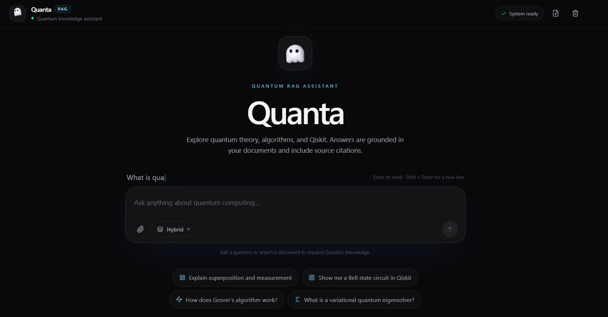
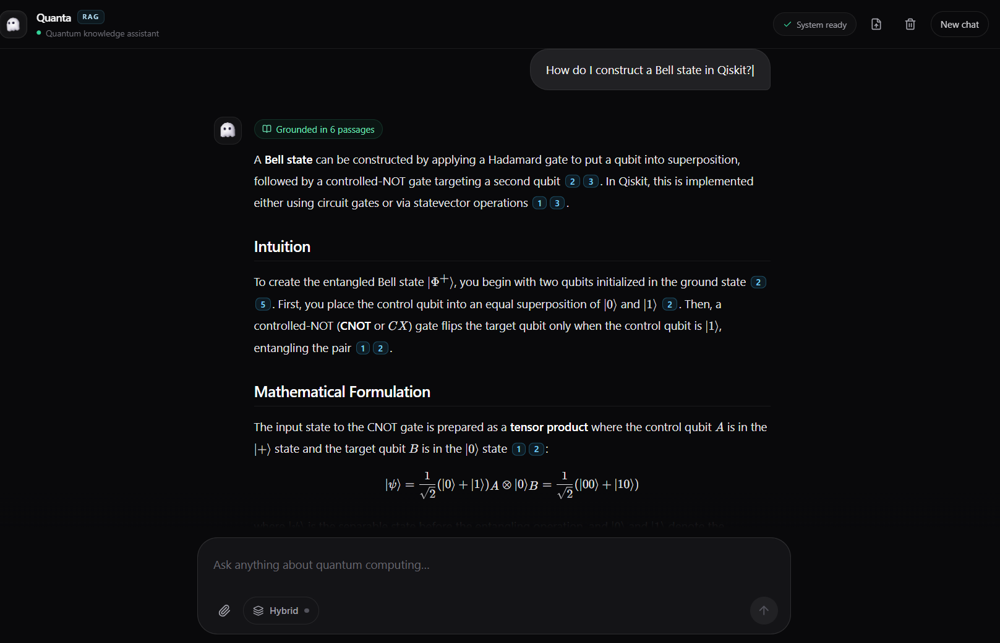

# Quanta: Full-Stack RAG Assistant for Quantum Computing ⚛️

Streaming, source-cited answers over a custom knowledge base. Gemini, ChromaDB, MMR + BM25 hybrid retrieval, FastAPI, Next.js.




A retrieval-augmented tutor for quantum computing theory and Qiskit. It answers from a curated knowledge base (IBM Quantum Learning courses, Qiskit guides and tutorials, research papers, Wikipedia) and from files you upload, cites the passages it used, and tells you clearly when it falls back to general knowledge.

The pipeline is written explicitly rather than hidden inside a black-box chain: LangChain provides loaders and splitters, while embedding, synchronization, retrieval, ranking and prompting are our own code, so every step can be inspected, tuned and measured.

## Features

- **Grounded answers with citations:** Gemini answers from numbered context passages and cites them inline (`[1]`, `[2]`); the CLI lists the cited sources with scores.
- **Honest fallback:** if no passage clears the relevance threshold, the answer starts with a fixed notice and uses general knowledge instead of pretending to quote the documents.
- **Header-aware chunking:** two-stage splitting (Markdown headers, then ~1000-character recursive chunks with overlap). The document title and section path are prepended to each chunk before embedding.
- **Format coverage:** PDF, Markdown/MDX, plain text, CSV and Jupyter notebooks (converted to markdown with fenced code, outputs dropped).
- **Explicit Gemini embeddings:** `RETRIEVAL_DOCUMENT` for chunks and `RETRIEVAL_QUERY` for questions, batched, with exponential-backoff retry on rate limits.
- **Incremental synchronization:** every chunk id is a SHA-256 fingerprint of its text, source and embedding configuration. Unchanged chunks are never re-embedded, stale chunks are deleted, and an interrupted ingestion resumes where it stopped.
- **MMR retrieval:** fetch 20 candidates, keep the 6 most relevant and least redundant.
- **Optional BM25 hybrid:** dense and keyword rankings fused with Reciprocal Rank Fusion, useful for exact identifiers such as `RealAmplitudes` or `CNOT`.
- **Two collections:** a curated knowledge base and a private `user_uploads` collection, searched together.
- **Persistent local storage:** ChromaDB on disk, no server, no Docker.
- **Web interface (Quanta):** a Next.js chat UI with streaming answers, markdown and highlighted Qiskit code, clickable citation pills, a source drawer showing section path and similarity score, drag-and-drop file upload and a ghost bot avatar, served by a small FastAPI layer (`main.py`).

## Tech Stack

- **Language:** Python 3.10+
- **Vector Database:** ChromaDB (persistent, cosine space)
- **Embeddings:** Google Gemini API (`gemini-embedding-001`, 768 dimensions, L2-normalized)
- **Generation:** Google Gemini API (`gemini-3.5-flash-lite`, configurable)
- **Orchestration helpers:** LangChain (`langchain-core`, `langchain-community`, `langchain-text-splitters`)
- **Sparse retrieval:** `rank-bm25`
- **API layer:** FastAPI + Uvicorn (newline-delimited JSON streaming)
- **Frontend:** Next.js (App Router), React, Tailwind CSS, Framer Motion, `react-markdown` + KaTeX, `bot-avatars`
- **Other tools:** NumPy, pypdf, nbformat, PyYAML, SHA-256 hashing

## System Architecture

```
 INGESTION (offline, resumable)                    QUERY (every question)
 ------------------------------                    ----------------------

 sources.yaml  +  /upload                                User Question
        |                                                      |
 Qiskit docs - arXiv - Wikipedia - local files        Gemini Embedding
        |                                             (RETRIEVAL_QUERY)
 Loaders (pdf / md / mdx / ipynb / csv / txt)                  |
        |                                         +------------+-------------+
 Header-aware chunking                            |                          |
 (Markdown headers -> recursive 1000/150)    Dense search               BM25 search
        |                                   (ChromaDB, 20)            (optional hybrid)
 Prepend "Title > Section" path                   |                          |
        |                                         +------------+-------------+
 SHA-256 hash per chunk                                        |
        |                                            RRF fusion (hybrid only)
 Already stored?  --yes--> skip (0 tokens)                     |
        |no                                          MMR re-ranking (keep 6)
 Gemini Embedding (RETRIEVAL_DOCUMENT)                         |
        |                                           Relevance gate (threshold)
 ChromaDB  (quantum_kb | user_uploads)                  |             |
                                                   passed         failed
                                                        |             |
                                              Numbered context   General-knowledge
                                                        |         prompt + notice
                                                        +------+------+
                                                               |
                                                    Gemini streaming answer
                                                               |
                                                Answer + [n] citations + sources
```

## How It Works

### 1. Ingestion
- Loads each file with a loader chosen by extension. MDX and notebook noise (frontmatter, JSX components, imports, link URLs) is stripped without touching code blocks.
- Splits Markdown-like documents at headings, then caps chunk size at about 1000 characters with 150 overlap. PDFs, text and CSV rows use the recursive splitter directly.
- Prepends `Context: Title > Section > Subsection` to every chunk before embedding.
- Computes a SHA-256 hash from the model, dimension, task type, source and chunk text, and embeds only hashes that are not already stored.

### 2. Retrieval
- Embeds the question as a query, fetches the 20 nearest chunks from each collection, and optionally adds BM25 candidates fused with Reciprocal Rank Fusion.
- Applies Maximal Marginal Relevance (λ = 0.7) to keep 6 chunks that are relevant without being near-duplicates of each other (overlapping chunks make plain top-k repetitive).
- Applies the relevance gate: the best chunk's cosine similarity must reach `RELEVANCE_THRESHOLD`; chunks within `THRESHOLD_MARGIN` below it are kept as supporting context.

### 3. Generation
- Injects the passages as `[1] ... [n]` into the prompt and asks Gemini for a tutor-style answer: intuition first, then formal details, with inline citations and no invented references.
- Extracts the `[n]` markers from the answer and maps them back to source file, section, page and similarity score.
- On a failed gate, the code itself prints the "Not found in your documents" notice and uses a general-knowledge prompt.

## Dataset

The knowledge base is defined in `sources.yaml` and built by `ingest.py`:

| Source | What | Why |
|---|---|---|
| **Qiskit documentation** (`Qiskit/documentation`) | IBM Quantum Learning courses, Qiskit in Classrooms modules, guides, tutorials | Current Qiskit APIs and well-structured theory; the archived Qiskit Textbook is deliberately not used because its code targets removed APIs |
| **arXiv papers** | Preskill (NISQ), Shor, Grover, VQE, QAOA, Cerezo et al. | Primary-source depth |
| **Wikipedia** | ~20 foundational pages | Definitions and background |
| **Your files** | Anything in `data/raw/local/` or added with `/upload` | Course notes, hackathon briefs, papers |

A full ingestion of the default sources produces roughly 10,000 chunks (about 2 million tokens to embed). It is resumable and incremental, and `--only` or the `paths` list in `sources.yaml` lets you start with a smaller slice.

## Getting Started

### Prerequisites
- Python 3.10 or higher
- A Google Gemini API key from [Google AI Studio](https://aistudio.google.com/apikey)
- `git` (to fetch the Qiskit documentation)

### 1. Clone the repository
Replace the placeholder URL with your actual GitHub repository URL.

```bash
git clone https://github.com/YOUR-USERNAME/quantum-rag-assistant.git
cd quantum-rag-assistant
```

### 2. Install dependencies
```bash
python -m venv .venv
```
Activate the virtual environment on Windows:
```powershell
.venv\Scripts\Activate.ps1
```
On macOS/Linux: `source .venv/bin/activate`

```bash
python -m pip install -r requirements.txt
```

### 3. Configure environment variables
Copy `.env.example` to `.env` and set your key:

```
GEMINI_API_KEY=your_gemini_api_key
GEMINI_GENERATION_MODEL=gemini-3.5-flash-lite
```

> **Security:** `.env` is git-ignored. Never commit API keys.

### 4. Build the knowledge base
```bash
python ingest.py --dry-run        # load + chunk + count, no API calls
python ingest.py --only wikipedia # small first run
python ingest.py                  # everything in sources.yaml
```
Re-running is cheap: unchanged chunks are skipped. Useful flags: `--limit N`, `--prune`, `--reset` (required after changing the embedding model or dimension), `--update` (pull the latest Qiskit docs).

### 5. Chat in the terminal
```bash
python cli.py
```

| Command | Action |
|---|---|
| `/upload <path>` | Index a PDF, md, mdx, txt, ipynb or csv into your private collection |
| `/sources` | Show every passage retrieved for the last answer, with scores |
| `/docs` | List indexed documents |
| `/hybrid on\|off` | Toggle dense + BM25 retrieval |
| `/threshold <0-1>` | Change the relevance threshold at runtime |
| `/clear_uploads` | Delete your uploads |

**Calibrating the threshold:** similarity scores depend on the embedding model and your corpus. Ask a few on-topic and a few off-topic questions, compare their best scores with `/sources`, and set `RELEVANCE_THRESHOLD` between the two groups.

### 6. Chat in the browser (Quanta web interface)

Two processes: the Python engine and the Next.js app (Node.js 20.9+ required).

```bash
# terminal 1 - Python RAG engine on http://127.0.0.1:8000
uvicorn main:app --port 8000

# terminal 2 - web interface on http://localhost:3000
cd web
npm install
npm run dev
```
Open http://localhost:3000. The status badge in the top bar turns green when the engine is reachable and shows the generation model. Settings (`web/.env.example`): `QUANTA_API_URL` if the engine is not on port 8000, and `NEXT_PUBLIC_QUANTA_LOGO` to replace the ghost with your own agent icon (put the image in `web/public/`).

The browser talks to Next.js route handlers (`/api/chat`, `/api/upload`, `/api/status`), which proxy to the engine, so no CORS setup is needed. The engine binds to localhost only and has no authentication: do not expose it to a network as is.

**Engine API** (`main.py`): `GET /` health, `POST /query` streams NDJSON events (`meta` with sources, then `token`s, then `done`), `POST /upload`, `GET /documents`, `DELETE /uploads`. Interactive docs at http://127.0.0.1:8000/docs.

## Configuration

All settings live in `config.py` and can be overridden in `.env`.

| Variable | Default | Meaning |
|---|---|---|
| `CHUNK_SIZE` / `CHUNK_OVERLAP` | 1000 / 150 | Chunk size and overlap in characters |
| `TOP_K` / `FETCH_K` | 6 / 20 | Chunks sent to the LLM / candidates before MMR |
| `MMR_LAMBDA` | 0.7 | 1.0 = pure relevance, 0.0 = pure diversity |
| `RELEVANCE_THRESHOLD` | 0.55 | Minimum best-chunk similarity to answer from documents |
| `THRESHOLD_MARGIN` | 0.10 | Extra tolerance for supporting chunks |
| `HYBRID_ENABLED` | false | Dense + BM25 fusion |
| `EMBED_BATCH_SIZE` / `EMBED_MIN_INTERVAL` | 32 / 0.6 s | Embedding request size and pacing |

## Project Structure

```
quantum-rag-assistant/
├── config.py        # settings and environment variables
├── loaders.py       # extension dispatcher, MDX cleaning, notebook converter
├── chunking.py      # header-aware + recursive splitting
├── embeddings.py    # Gemini embeddings, retry, SHA-256 hashing
├── store.py         # ChromaDB, hash sync, MMR, BM25 hybrid, relevance gate
├── ingest.py        # knowledge-base builder (+ upload ingestion)
├── rag.py           # prompts, retrieval + generation, citation extraction
├── cli.py           # interactive chat (terminal)
├── main.py          # FastAPI server: streaming /query, /upload, /documents
├── sources.yaml     # dataset definition
├── requirements.txt
└── web/             # Next.js interface "Quanta"
    ├── app/                 # page.tsx, layout, api/{chat,upload,status} proxy routes
    ├── components/          # quanta-logo, chat-input, chat-message, source-drawer, markdown, ...
    └── lib/                 # NDJSON stream client, types, helpers
```

## Phase Progression

This project reuses the lessons of the [Hybrid GraphRAG Movie & TV Recommendation Engine](https://github.com/YOUR-USERNAME/hybrid-graphrag-recommender): explicit embeddings, SHA-256 incremental synchronization, asymmetric task types, deterministic pipelines instead of LLM-generated queries, and optional agent memory.

### Stage 1 - Vector RAG Backend and CLI (done)
Header-aware chunking, explicit Gemini embeddings, hash-synchronized dual ChromaDB collections, MMR retrieval with a relevance gate and labeled fallback, optional BM25 hybrid, grounded Gemini answers with citations, and a terminal interface with file upload.

Why no GraphRAG here: quantum learning material is conceptual, unstructured prose where explanatory chunks matter more than extracted entity edges, and LLM-based graph extraction would add cost and noise for little gain on single-topic questions.

### Stage 2, Part 1 - Web Interface (current)
FastAPI streaming layer plus a Next.js chat UI: animated hero with a cursor lens on the headline and cycling greetings, floating composer, streamed markdown answers with highlighted code, clickable citations that open a source drawer, file upload, hybrid toggle and a status badge. State is kept in the browser only (no database, no agent memory).

### Stage 2, Part 2 - Evaluation and extras (planned)
See below.

## Future Improvements

- **Benchmark evaluation:** a labeled question set to compare chunk sizes, plain similarity vs MMR vs BM25 hybrid, and threshold choices on retrieval hit-rate and answer faithfulness.
- **Query rewriting for follow-ups:** turn "explain that more" into a standalone search query before retrieval (the UI already sends recent turns for conversational generation).
- **Learning-path concept graph:** a small hand-curated graph of prerequisites (for example Grover → amplitude amplification) to recommend what to study next, built deterministically as in the movie recommender.
- **Optional long-term memory:** persistent learner preferences and auditable retrieval traces (the approach from the movie recommender), deliberately left out of this version.
- **Deployment:** hosted vector storage, the engine behind authentication, and the front end on Vercel.

## Notes

- Qiskit documentation is distributed under CC BY-SA 4.0 and Wikipedia text under CC BY-SA; arXiv papers keep their own licenses. Downloaded corpora live in `data/raw/`, which is git-ignored, and are fetched by `ingest.py` rather than redistributed.
- Qiskit changes quickly. The assistant is instructed to flag version-dependent code, and `python ingest.py --update` refreshes the documentation.